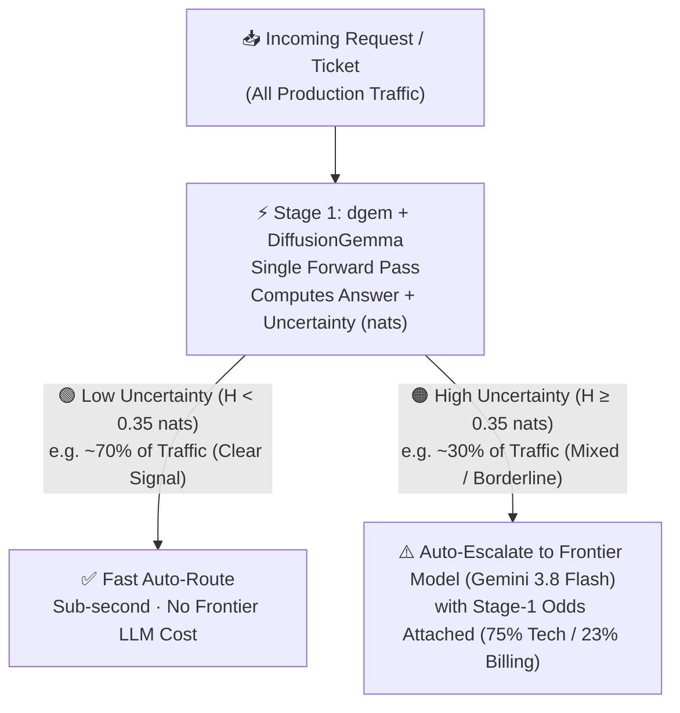

For decades, software engineers and product teams had to choose between two extremes when building classification and decision systems: **fast, rigid classical models** (like Naive Bayes, Logistic Regression, and BERT) or **slow, expensive autoregressive Large Language Models** (chat LLMs such as Gemini).

**DiffusionGemma** introduces a third paradigm: **Discrete Diffusion Decision Models**.

> ✨ **Interactive Walkthrough**: New to decision models? [**Open the plain-language walkthrough ➔**](https://googlecloudplatform.github.io/dgem/visualizer.html): what a decision model is, one pass vs. word-by-word, when to trust an answer (hesitation), and built-in guardrails. The full version, with a hesitation-gating walkthrough and a glossary, is the **Concepts** tab in Decision Studio (`./bin/dgem serve`).

---

## 0. Product & Executive Overview: Why Decision Models & How the Entropy Gate Works

If you are a Product Manager, Engineering Leader, or Systems Architect, here is the core problem `dgem` solves—without the machine learning jargon:

### The Three Generations of Classification
1. **Traditional Predictive ML (`~10 ms` · Fast & Trustworthy, Slow to Build)**:
   Give a traditional model 10,000 labeled customer tickets and it will classify new ones in milliseconds with a genuine confidence score (e.g., `99% Billing` vs. `51% Billing`). **The catch:** Every time your product adds a new routing department or policy rule, your team has to collect new data and retrain the model from scratch.
2. **Autoregressive LLMs (seconds · Instant Setup, Slow & Overconfident at Runtime)**:
   Chat models let you define categories on the fly in plain English (*zero-shot*). **The catch:** They generate text one word at a time from left to right. Using a chat LLM just to classify a ticket into three fields is like asking a novelist to write a paragraph just to check a box—and because it outputs a plain string (`"department": "Technical"`), **it hides whether the model was 99% certain or guessing 51/49 on a coin flip**.
3. **Decision Models (`dgem` + `DiffusionGemma` · sub-second · Zero-Shot Setup + Per-Field Uncertainty)**:
   Instead of generating words left to right, `DiffusionGemma` evaluates all of your decision blanks simultaneously on a fixed canvas in **one single pass**. Because it locks directly onto your allowed options, it cannot emit invalid JSON or an off-menu label—and it returns a per-field **uncertainty score (`Shannon Entropy` in `nats`)**. That score is a strong starting signal, not a guarantee: see [how it can be fooled and how `dgem` checks it](/dgem/confidence/overview/).

### How the Entropy Gate Works (The "Triage Nurse vs. Specialist" Pattern)
In many products, **most incoming requests are obvious** (e.g., *"Our API is returning 502 Bad Gateway"*), while **a minority are genuinely mixed** (e.g., *"Our API is returning 502 Bad Gateway AND we are disputing our $45,000 Q3 invoice"*).

Instead of sending all of your traffic to a slow, expensive frontier reasoning model—or letting a fast model guess blindly on ambiguous edge cases—`dgem` uses an **Entropy Gate**:

*Illustrative numbers below; your split depends on your traffic and threshold.*



* **When the signal is clear (`H < 0.35 nats`)**: `DiffusionGemma` puts nearly all the probability on one answer. The request takes the **Green Fast Lane**, finishing in sub-second latency at a fraction of LLM cost.
* **When the request contains conflicting signals (`H ≥ 0.35 nats`)**: `DiffusionGemma` detects its own internal tug-of-war (for example `75% Technical` vs. `23% Billing`) and raises an **Amber Flag**. Your application routes **only that ambiguous slice** to a frontier model (or human reviewer), passing along `DiffusionGemma`'s odds as a diagnostic clue. A size-normalized gate ($\tilde{H} \ge 0.16$, the Hesitation % scale) works across questions with different numbers of options; fit the threshold on your own labelled data ([Calibrate your policy](/dgem/confidence/calibrate-your-policy/)).

---

## 1. The Three Eras of Decision Systems (Technical Deep Dive)

```
Era 1: Classical Statistical ML   --> Era 2: Classical Symbolic NLP --> Era 3: Autoregressive GenAI --> The Emerging Era: Decision Models
(Naive Bayes, SVM, XGBoost)           (N-grams, HMMs, WFSTs)            (Gemini, Gemma)                  (Discrete Block Diffusion / dgem)
Bag-of-Words / Zero Context           Local Sliding Window              Causal Sequential Next-Token     Non-Autoregressive Canvas Readout
Microsecond / Cheap CPU               Millisecond / C++ Rulebooks       Multi-Second / Heavy GPU Loops   Sub-Second / Guaranteed Schema
```

### Era 1: Classical Statistical ML & Discriminative Encoders (1960s–Present)
* **Core Algorithms**: Naive Bayes, Logistic Regression, Support Vector Machines (SVMs), Random Forests, XGBoost, Dual-Encoders (`GTR` / `Sentence-T5`), Tabular Foundation Models (`TabPFN`), and Fine-Tuned Cross-Encoder Heads (`BERT`, `DeBERTa-v3`).
* **Mechanism**: Treat text as an unordered Bag-of-Words (BoW) matrix, static linear classification head, or pooled dense embedding vector $u \in \mathbb{R}^d$:
  $$P(C \mid w_1, \dots, w_n) \propto P(C) \prod_{i=1}^n P(w_i \mid C)$$
* **Strength**: Microsecond to millisecond inference, minimal memory footprints, and fixed output schemas.
* **Fatal Flaw**: **Zero-Shot Rigidity, Late-Pooling Loss & Independent Heads**. Classical statistical ML cannot model word order, grammatical modifiers, or negation. Fine-tuned encoder heads understand context but require dataset relabeling and weight retraining whenever policies change—and evaluating 3 questions requires 3 separate classification heads that cannot attend to each other.

<details class="term-aside">
<summary>💡 <strong>Concept Aside: What about pairing a <code>GTR</code> Dual-Encoder with a Zero-Shot Tabular FM (<code>TabPFN</code> / <code>TabFM</code>)?</strong> <em>(click to expand)</em></summary>

* **Why Engineers Ask**: Can we encode the input and policy labels with a `GTR` (`Sentence-T5`) dual encoder, normalize the similarity vectors into a table, and run a zero-shot tabular model (`TabPFN`) on top?
* **The Two Bottlenecks**:
  1. **Late Vector Pooling**: `GTR` compresses a 1,000-token input into a single vector $u \in \mathbb{R}^d$ *before* reading your policy rules, destroying token-to-token alignment (e.g., SQL parameter drift in a tool call, or `50–75% < 100%` in a numeric claim).
  2. **Support-Row Requirement**: `TabPFN` requires **labeled support rows ($N_{\text{support}} > 0$)** in its tabular context grid, whereas `dgem`'s `.json.tmpl` policies compile **zero-shot ($N=0$)** via full token-level cross-attention.
* **Deep Dive**: Read the full breakdown in [Discrete Diffusion vs. Autoregression (§5)](/dgem/confidence/architecture/#5-architectural-faq-can-dual-encoders-gtr--tabpfn-replace-a-decision-model-or-do-you-need-test-time-compute) and the [Glossary & Mental Models](/dgem/glossary/).

</details>

### Era 2: Classical Symbolic NLP & Automata (1990s–Present)
* **Core Algorithms**: Regular Grammars, Hidden Markov Models (HMMs), Weighted Finite-State Transducers (WFSTs like OpenFst, Google Sparrowhawk, NVIDIA NeMo).
* **Mechanism**: Model sequential transitions using regular languages (Chomsky Type-3) and shortest-path algorithms over tropical semirings:
  $$\text{ShortestPath}(T \circ \text{Input} \circ V)$$
* **Strength**: Extremely fast (milliseconds in C++), deterministic, zero hallucinations, and mathematically verifiable.
* **Fatal Flaw**: **Local context horizon (1–3 token sliding window)**. WFSTs cannot build full-sentence dependency parse trees. As language complexity increases, grammar rulebooks explode into combinatorial conflicts (e.g., tuning a title rule for *"Dr. Smith"* causes street thoroughfares like *"Ocean Dr."* to expand to *"Ocean doctor"*).

### Era 3: Autoregressive Generative AI (2018–Present)
* **Core Algorithms**: Causal Transformer Decoders (for example Gemini and Gemma).
* **Mechanism**: Autoregressive sequence generation. Starting from the prompt, the model serially predicts token $t+1$ conditioned exclusively on preceding tokens $t_1 \dots t$:
  $$P(w_1, \dots, w_T) = \prod_{t=1}^T P(w_t \mid w_{<t})$$
* **Strength**: Deep semantic reasoning, world knowledge, and zero-shot instruction following.
* **Fatal Flaws for Structured Decisions**:
  1. **The Sequential Token Tax**: To output a single word like `"billing"`, the model must serially generate thought rationales, markdown tags, or JSON formatting loops, consuming seconds per request.
  2. **Formatting & Syntax Drift**: Autoregressive models can emit invalid JSON, wrap responses in conversational filler, or succumb to prompt injections.
  3. **Strict Causal Masking**: Tokens generated early cannot attend to tokens that appear later in the sequence.

---

## 2. The Four Dilemmas of Decision Engineering

When deploying mission-critical systems (such as high-volume customer triage, automated trading, brand safety gating, or real-time speech synthesis), teams encounter four architectural dilemmas:

| Decision Architecture Dilemma | Classical Statistical ML (Naive Bayes / SVM) | Symbolic Automata (WFSTs) | Autoregressive LLMs (e.g. Gemini) | Discrete Diffusion Decision Models (`dgem`) |
| :--- | :--- | :--- | :--- | :--- |
| **1. The Context Horizon Dilemma** | **Zero context** (Bag-of-Words). Fails on negation. | **Local window (1–3 tokens)**. Fails on semiotic polysemy. | **Full sequence (unidirectional)**. Deep reasoning. | **Full sequence (bidirectional)**. Deep syntax + slot cross-attention. |
| **2. The Latency & Compute Tax** | **Microseconds** (&lt; 1 ms on CPU). | **Single-digit ms** (1–5 ms on CPU). | **Multi-second** (sequential loop). | **Sub-second** (single forward pass). |
| **3. The Syntactic Guarantee** | Categorical output guaranteed. | Regular grammar output guaranteed. | **Probabilistic formatting**. Can hallucinate or drift. | **100% Schema-Guaranteed**. Readout directly into pre-allocated slots. |
| **4. Uncertainty Calibration** | **Overconfident** ($0.9999$ or $0.0001$). Unusable. | Static arc weights. No probabilistic variance. | Logprobs available, but tied to serial token branches. | **Per-slot probabilities & entropy** ($\pm\sigma$ and $H$); hesitation-gating and per-domain calibration ([details](/dgem/confidence/overview/)). |

---

## 3. How Discrete Diffusion Models Work

Rather than generating sequential text, DiffusionGemma treats a decision as a **discrete canvas denoising problem**:

```
[System Schema] + [User Input Data] + [Pre-Allocated Canvas: <slot_1> <slot_2> <slot_3>]
                                     │
                      ┌──────────────┴──────────────┐
                      │ Bidirectional Self-Attention │
                      │   (Prompt <---> Canvas)      │
                      └──────────────┬──────────────┘
                                     │
                  [Single-Pass Discrete Denoise / Readout]
                                     │
              ┌──────────────────────┼──────────────────────┐
              ▼                      ▼                      ▼
      Slot 1: "billing"       Slot 2: "yes"         Slot 3: "4 (frustrated)"
      (confidence: 99.1%)     (stderr: ±0.002)       (entropy: 0.04 nats)
```

### 1. The Pre-Allocated Canvas
Instead of starting an open-ended token generation loop, the system sets aside a fixed-width discrete canvas (typically 32 to 256 tokens). Each question in your decision schema ([`templates/support_triage.json.tmpl`](https://github.com/GoogleCloudPlatform/dgem/tree/main/templates)) is assigned specific token slots on this canvas.

### 2. Full Bidirectional Attention
While autoregressive LLMs apply a causal mask (token 5 cannot look ahead at token 20), DiffusionGemma applies **bidirectional self-attention** across the entire prompt and canvas.
* The slot tokens attend to all prompt tokens simultaneously.
* Crucially, **the slot tokens attend to each other**. The model's classification of `team = engineering` directly influences its confidence on `urgent = yes` during the exact same forward pass.

### 3. Single-Pass Slot Readout (Restricted Softmax)
At the target slot position, the model projects the latent representation directly against the authorized token vocabulary for that question. For a boolean question (`"type": "boolean"`), the softmax is restricted strictly to `{ "yes", "no" }`. For a categorical question (`"type": "choice"`), the projection is restricted strictly to the declared category options.

### 4. Dual-Mode Uncertainty Telemetry & Epistemic Calibration (`ChaosNLI`)
Because decision models project onto restricted candidate vocabularies rather than open-ended decoding paths, they expose clean per-slot probabilities. These are a strong *uncertainty signal*, though not automatically *calibrated* probabilities (calibration to a real deployment needs labeled data; see [Confidence beyond Shannon](/dgem/confidence/overview/)):
* **Empirical Standard Error ($\pm\sigma$)**: On Apple Silicon Metal, multi-seed perturbation noise draws reveal whether the model has high consensus ($\pm 0.0000$) or ambiguity ($\pm 0.1500$).
* **Monotonic Shannon Entropy ($H = -\sum p_k \ln p_k$)**: On items where human annotators disagree (for example `ChaosNLI`, which has many annotators per item, included in `dgem bench-calibration`), DiffusionGemma's single-pass entropy tends to be higher, and accuracy lower, than on items where annotators agree. That makes an entropy threshold a natural trigger to abstain or escalate to a reasoning model.

> **But raw entropy can be fooled.** `DiffusionGemma` has a habit of picking whichever option is listed first ("Box A"). On a borderline question that habit can make a coin flip *look* like near-certainty, and the entropy gate then waves it through. **[Confidence beyond Shannon: hesitation-gated decisions](/dgem/confidence/overview/)** explains how `dgem` handles this: it hands hesitant answers to a larger model, keeps the answer template and prompt layout from distorting the probabilities, monitors option-order bias on every release, and calibrates per domain.

### 5. Templates as Executable Decision Policies (`Policy-as-Code`)
In classical ML or fine-tuned encoder architectures (such as a fine-tuned `DeBERTa-v3` safety classifier), the decision policy is baked into static linear classification weights. If security engineering adds a 4th trajectory hijack state (`injection_point` vs. `hijacked` vs. `failed_injection`), the classifier head must be retrained.

In `dgem`, a declarative `.json.tmpl` file **is** the classifier head:
* **Zero-Shot Policy Compilation**: A new policy (trajectory-hijack detection, prompt-injection screening, RAG grounding, passage relevance) is a template edit, with no fine-tuned weights. `dgem bench-calibration` runs a small suite of such policies over public datasets so you can check them yourself.
* **Joint Multi-Slot Conditioning (`slot_1 <-> slot_2`)**: Unlike encoder classifiers that require separate models for binary toxicity (`yes`/`no`) and ordinal severity (`1–5`), a single `.json.tmpl` policy evaluates all slots simultaneously in one forward pass.

---

## 4. The Unified AI Architecture: A Three-Tier Hierarchy

DiffusionGemma does not replace FSTs or conversational LLMs; it fills the critical missing middle tier of modern enterprise architectures:

```
┌────────────────────────────────────────────────────────────────────────┐
│ Tier 1: Deterministic Fast Path (C++ OpenFst / WFSTs)                  │
│ Latency: milliseconds | Compute: CPU | Scope: routine tokens           │
│ Use Case: Currency ($5.99), phone numbers, dates, punctuation, regex.  │
└───────────────────────────────────┬────────────────────────────────────┘
                                    │ Unresolved Ambiguity / Tied Arc Weights
                                    ▼
┌────────────────────────────────────────────────────────────────────────┐
│ Tier 2: Discrete Diffusion Decision Model (DiffusionGemma / dgem)      │
│ Latency: sub-second | Compute: GPU / Metal | Scope: ambiguous cases    │
│ Use Case: Polysemy, AgentDrift guardrails, RAG grounding, NLU routing. │
└───────────────────────────────────┬────────────────────────────────────┘
                                    │ High Epistemic Entropy (H > 0.30 nats)
                                    ▼
┌────────────────────────────────────────────────────────────────────────┐
│ Tier 3: Conversational Autoregressive LLM (Vertex AI Gemini)           │
│ Latency: seconds | Compute: large model | Scope: hesitant cases only   │
│ Use Case: Multi-hop scratchpad reasoning (ANLI-R3), open generation.   │
└────────────────────────────────────────────────────────────────────────┘
```

1. **Tier 1 (The Deterministic Fast Path)**:
   Use classical C++ WFSTs or regular expressions for unambiguous transformations. If text contains `"$5.99"`, an FST expands it to *"five dollars ninety-nine cents"* in about a millisecond. Never pay GPU overhead for deterministic string replacement.
2. **Tier 2 (The Discrete Decision Model)**:
   When inputs exhibit semantic ambiguity, polysemy, negation, or require multi-rubric policy enforcement, route to **DiffusionGemma**. In one forward pass, it resolves the decision policy with full bidirectional context, 100% schema enforcement, and per-slot Shannon entropy $H$.
3. **Tier 3 (The Conversational Reasoning Engine)**:
   When DiffusionGemma's uncertainty telemetry flags high uncertainty ($H > 0.30$ nats—such as on human-contested `ChaosNLI` items or multi-hop `ANLI-R3` traps), escalate to a Thinking / Autoregressive LLM (like Google Cloud Vertex AI Gemini) to execute serial scratchpad reasoning or synthesize an explanation for a human reviewer.

---

## 5. Summary

| Question | Classical ML / Encoders | Autoregressive LLMs | Discrete Diffusion Decision Models (`dgem`) |
| :--- | :--- | :--- | :--- |
| **How does it decide?** | Feature weights / static linear heads | Token-by-token sequential prediction | **Bidirectional canvas slot denoising** |
| **How are policies updated?** | Relabel dataset & retrain weights | Prompt engineering + output parser | **Declarative `.json.tmpl` (`Policy-as-Code`)** |
| **How fast is it?** | Microseconds – milliseconds | Seconds | **Sub-second (1 forward pass)** |
| **Can slots attend to each other?** | No (independent heads) | Unidirectional (`left -> right` only) | **Yes (`slot_1 <-> slot_2` bidirectionally)** |
| **Does it know when it's unsure?** | Overconfident out-of-domain | Uncalibrated sequence logprobs | **Often: entropy rises with human disagreement, but option order can hide it ([hesitation-gating](/dgem/confidence/overview/))** |
| **Can it handle vision?** | Separate vision classifiers | Yes (multimodal autoregression) | **Yes (native SigLIP vision canvas)** |

By decoupling **deep contextual reasoning** from **slow sequential text generation**, DiffusionGemma and `dgem` bring the power of 26B foundation models to sub-second, zero-shot decision engineering.
