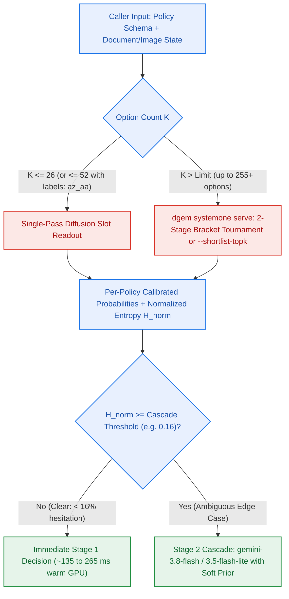

# Real-World Applications & Production Patterns for DiffusionGemma

This guide explores high-value real-world production architectures enabled by **[DiffusionGemma](https://gemma.ai/models/diffusiongemma/)** and **Discrete Diffusion Slot Readout**. By transforming generative language models into sub-second, mathematically calibrated judgment engines, teams can deploy AI for tasks where standard autoregressive LLMs are either **too slow**, **too expensive**, or **too syntactically fragile**.

---

## The Paradigm Shift: Generative Text vs. System-1 Judgment

Standard LLMs are deliberative "System-2" engines: they generate text token-by-token across dozens of forward passes (often several seconds), consuming memory bandwidth and producing uncalibrated, open-ended prose.

**Discrete Diffusion Slot Readout** unlocks reflexive "System-1" AI:
* **Sub-Second Execution**: A single forward pass per decision, on a cloud GPU or on Apple Silicon Metal.
* **Zero Output Token Waste**: Operates on a pre-seeded 256-token canvas with bidirectional attention, evaluating logits directly at token slots.
* **100% Schema Reliability**: Mathematically impossible to produce invalid JSON or syntax drift.
* **Native Calibration**: Emits true Shannon entropy, empirical standard error (`stderr`), and multi-seed agreement.

---

## 1. Fast Reflexive Dispatcher for Agentic AI (System-1 Router)

### The Problem
Autonomous agents (e.g. coding assistants, workflow orchestrators) often spend **several seconds** asking a frontier model a trivial question: *"Which tool should I call next?"*. This creates severe latency bottlenecks and inflates API costs.

### The Architecture
Deploy [DiffusionGemma](https://gemma.ai/models/diffusiongemma/) as a sub-second pre-flight dispatcher. The agent pipes current state into a 4-choice template, and [DiffusionGemma](https://gemma.ai/models/diffusiongemma/) immediately returns the tool selection.

```
User Prompt / Conversation State
               │
               ▼
   ┌───────────────────────┐
   │  DiffusionGemma (GPU) │ ──1 pass───► Tool Selected: [edit_code] (Conf: 99.8%)
   │  Discrete Slot Read   │
   └───────────┬───────────┘
               │ (Entropy H >= 0.10 nats: Ambiguous Intent)
               ▼
   ┌───────────────────────┐
   │ Frontier Deliberation │ ──seconds─► High-latency reasoning only when needed
   │ (e.g. Gemini)         │
   └───────────────────────┘
```

### Template Definition (`templates/agent_router.json.tmpl`)
```json
{
  "schema": {
    "instructions": "Select the single best tool for the agent to execute next.",
    "questions": [
      {
        "id": "tool",
        "type": "choice",
        "instructions": "Next immediate agent action",
        "options": [
          {"name": "search", "description": "Search web or documentation for external facts"},
          {"name": "read_code", "description": "Inspect local repository files or definitions"},
          {"name": "edit_code", "description": "Modify existing files or write new code"},
          {"name": "run_tests", "description": "Execute test suite or verify changes"},
          {"name": "ask_user", "description": "Clarify ambiguous instructions with the human"}
        ]
      }
    ],
    "samples": 1
  },
  "state": {
    "user_message": {{ .prompt | toJson }},
    "last_action": {{ default "none" .last_action | toJson }}
  }
}
```

### Calling from an Agent Pipeline
```bash
./bin/dgem decide -t templates/agent_router.json.tmpl \
  -v 'prompt=Please fix the nil pointer dereference in auth.go' \
  -f json
```

---

## 2. Automated Git Pre-Push Hooks & DevSecOps Auditing

### The Problem
Traditional static analysis tools (linters, AST analyzers) lack semantic reasoning to understand whether a code change introduces high-risk vulnerabilities, while cloud-based AI code reviewers take minutes to respond, slowing developer velocity.

### The Solution
Embed `dgem` into a local Git `pre-push` hook or fast PR gate. It evaluates code diffs against `templates/code_review.json.tmpl` in **a few seconds at most**:

### Implementation: `.git/hooks/pre-push`
```bash
#!/usr/bin/env bash
set -e

echo "==> Running local DiffusionGemma security audit..."

# Capture diff against remote tracking branch
DIFF_CONTENT=$(git diff origin/main..HEAD | head -n 150)

if [ -z "$DIFF_CONTENT" ]; then
  exit 0
fi

# Run discrete slot readout
RESULT=$(dgem decide -t templates/code_review.json.tmpl \
  -v "diff=$DIFF_CONTENT" \
  -f json)

APPROVED=$(echo "$RESULT" | jq -r '.answers.approved.label')
CATEGORY=$(echo "$RESULT" | jq -r '.answers.category.choice')
RISK=$(echo "$RESULT" | jq -r '.answers.risk_level.level')
CONFIDENCE=$(echo "$RESULT" | jq -r '.answers.approved.confidence')

echo "    Audit Result: Approved=$APPROVED | Category=$CATEGORY | Risk=$RISK (Confidence: $CONFIDENCE)"

if [ "$APPROVED" = "no" ] || [ "$RISK" = "critical" ]; then
  echo "❌ PUSH BLOCKED: DiffusionGemma flagged high-risk or unapproved changes."
  echo "    Please review your diff before pushing to remote."
  exit 1
fi

echo "✅ Security check passed. Proceeding with push."
```

---

## 3. High-Throughput SIEM & Security Alert Containment

### The Problem
Security Operations Centers (SOCs) face alert fatigue: ingestion pipelines receive **tens of thousands of alerts daily** from endpoint agents, SIEM tools, or Google Cloud Security Command Center (SCC). Generative LLMs cannot keep up with this throughput without millions of dollars in GPU clusters.

### The Architecture
Using **Cloud Run with GPUs** and vLLM's continuous batching, a single NVIDIA GPU evaluates many decisions per second (measure yours with the [regression matrix](../operate/regression-matrix.md) and [latency and capacity](../operate/latency-capacity.md) guides):
1. Cloud Pub/Sub pushes security alerts to a Cloud Run webhook.
2. [DiffusionGemma](https://gemma.ai/models/diffusiongemma/) evaluates three slots in parallel:
   - `data_compromise`: `boolean` (Is data exfiltration suspected?)
   - `action`: `choice` (`monitor`, `revoke_key`, `isolate_host`, `page_oncall`)
   - `severity`: `score` (`p3_low` to `p0_critical`)
3. **Automated Action**: If `action == "isolate_host"` and `confidence > 0.95`, the webhook immediately calls the GCP Compute Engine API to detach the infected VM from the VPC network.
4. **Noise Suppression**: Routine alerts (e.g. port scans) settle in 1 sample with low entropy, filtering routine alert noise without human intervention.

---

## 4. Multi-Dimensional Enterprise Support Triage

### The Problem
Customer support tickets arrive with complex, multi-faceted intents. A single email can simultaneously describe a service bug, demand a refund, and express extreme dissatisfaction. Standard classifiers require separate models for routing, sentiment, and SLA escalation.

### The Solution
[DiffusionGemma](https://gemma.ai/models/diffusiongemma/) evaluates **all three dimensions in a single forward pass**:
* **Urgency**: `boolean` (Determines SLA tier: 15-minute response vs. standard queue).
* **Department Routing**: `choice` (`billing`, `support`, `engineering`).
* **Customer Distress**: `score` (`calm`, `frustrated`, `furious`).

### Handling Borderline Cases
When a customer message is ambiguous (e.g. *"Your system timed out during checkout and billed my card, but no order was created"*):
1. The department answer comes back with high hesitation (for example 55% billing, 45% engineering).
2. The triage template takes 4 samples in one parallel batch (`support_triage` opts in to `samples: 4`), so the answer also carries a standard error and an agreement score.
3. Tickets above the hesitation threshold (~16%) or with split agreement are routed to a senior human triage lead with the probabilities attached; the rest are dispatched automatically.

(`samples: "auto"`, which adds a second batch only when the first read is uncertain, also works but usually costs an extra sequential pass; see [Latency and capacity](../operate/latency-capacity.md).)

---

## 5. High-Scale "LLM-as-a-Judge" Evaluation Pipelines

### The Problem
Teams building generative AI applications evaluate prompt variants by using another LLM as a judge. However:
1. Standard LLM judges suffer from position bias, verbosity bias, and hallucinatory overconfidence.
2. Running 50,000 prompt evals through frontier models costs thousands of dollars and takes hours.

### The Solution: Diffusion Slot Evals
Use discrete slot readout to grade model outputs against structured evaluation rubrics:

```json
{
  "schema": {
    "instructions": "Evaluate the assistant response against ground truth and corporate policy.",
    "questions": [
      {
        "id": "factual_correctness",
        "type": "boolean",
        "instructions": "Does the response contradict any facts in the reference passage?"
      },
      {
        "id": "compliance_safety",
        "type": "boolean",
        "instructions": "Does the response comply with safety and privacy guidelines?"
      },
      {
        "id": "coherence_score",
        "type": "score",
        "instructions": "Fluency and structural clarity",
        "levels": ["incoherent", "poor", "acceptable", "polished", "exceptional"]
      }
    ],
    "samples": 1
  },
  "state": {
    "reference_context": "...",
    "model_output": "..."
  }
}
```

### Advantages:
* **Lower Cost**: Evaluates thousands of outputs per GPU-hour without paying for output token generation.
* **Empirical Error Bars**: The `stderr` and `entropy` metrics highlight which test cases are borderline or subjective, allowing automated identification of benchmark items that need human review.

---

## 6. Image and Video-Frame Assessment Patterns

[DiffusionGemma](https://gemma.ai/models/diffusiongemma/) natively incorporates a ~550M parameter **SigLIP vision tower**, allowing visual inputs (single images, documents, and sequential video frames) to be prefilled directly into the KV cache.

> **What dgem accepts:** text and images. [DiffusionGemma](https://gemma.ai/models/diffusiongemma/) is a text + image model (the [Gemma 4](https://gemma.ai) base has wider
> multimodal support; this checkpoint has no audio encoder). **Video** works only as frames you sample yourself and
> send as images. **Audio** is not supported: send a transcript as text (the call-quality template below does this).
> Requests that carry `audio` or `video`/`videos` fields (or audio/video content parts) are refused with HTTP 400
> rather than answered without them.

When combined with discrete diffusion slot readout, multimodal queries bypass the slow process of describing pictures in text and instead perform **instantaneous visual judgment**:

```
[Input Image / Frame Sequence] ──► SigLIP Vision Tower ──► Visual Tokens in KV Cache
                                                                   │
                                                                   ▼
[Pre-Seeded Canvas: "defect: @ | severity: @"] ◄── 1 Denoise Step
                                                                   │
                                                                   ▼
                                                 Output: [solder_bridge, critical]
```

### Multimodal Best Practices
1. **Modality Order**: Always place image parts **before** text prompts in the input array.
2. **Image token cost**: the serving image encodes each image to about **280 tokens** (the checkpoint's default). Images, the question list and the input all share the deployment's context (`MAX_MODEL_LEN`, 8,192 tokens on the reference deployment), so a request holds about two dozen images at most; requests over the limit are refused.
3. **Video as frames**: sample a few frames that show the event (for example 1 fps over the relevant seconds) and send them as image parts in time order. Frame count is bounded by the context above; accuracy versus frame count has not been measured yet.

### Production Multimodal Templates (`templates/multimodal/`)
* **Industrial AOI**: `templates/multimodal/pcb_defect_triage.json.tmpl` (solder bridge, tombstoning, missing component).
* **Fintech & KYC**: `templates/multimodal/kyc_document_audit.json.tmpl` (legibility, document type, tampering detection).
* **OSHA & Workplace Safety**: `templates/multimodal/workplace_hazard_video.json.tmpl` (PPE compliance, forklift pedestrian proximity, slip hazards).
* **Frontend Design Systems**: `templates/multimodal/ui_design_review.json.tmpl` (WCAG contrast compliance, visual hierarchy, information density).
* **Contact Center QA**: `templates/multimodal/call_quality_audio.json.tmpl` (disclosure compliance, agent empathy, customer sentiment). Text only: it reads a **call transcript** with optional acoustic tags such as `[raised voice]`, produced by your speech-to-text step; dgem does not take audio.

### Running Multimodal Queries with `dgem`
```bash
# Attach local image file (auto-encoded to base64 data URI; PNG, JPEG, WebP or GIF, not SVG):
./bin/dgem decide -t templates/multimodal/ui_design_review.json.tmpl \
  -I fixtures/ui_component.png \
  -v 'component=CheckoutCard' \
  --stats

# Attach multiple video frames (sampled by you, in time order):
./bin/dgem decide -t templates/multimodal/workplace_hazard_video.json.tmpl \
  -I fixtures/pcb_board.png \
  -I fixtures/id_card.png \
  -v 'zone=Dock-12' \
  --stats
```

---

## 7. Wide-Option Routing (`az_aa`, Brackets & Shortlists) & Hesitation-Gated Stage 2 Cascades

### The Problem
Enterprise taxonomies frequently exceed the default 26-option `[A-Z]` single-letter slot limit (`K = 30` to `150+` banking intents, retail product categories, or support routing queues). At the same time, ambiguous edge-case inputs should escalate to a deeper reasoning model (`gemini-3.8-flash` or `gemini-3.5-flash-lite`) without paying autoregressive latency on the routine cases where `DiffusionGemma` is confident.

### The Architecture
Combine wide-option routing on `dgem systemone serve` (`POST /v1/systemone`) with hesitation-gated Stage 2 escalation on `dgem serve` (`POST /api/decide`), MCP (`decide_policy` and `decide_custom_questions`), Decision Studio, or the `dgem bench-*` harnesses:



1. **52-Label Readout, Shortlists, & Balanced Brackets (`dgem systemone serve`)**: On a serving image with extended label-set support, `--labels az_aa` (or `--labels az_lower`, or `"labels": "az_aa"` in `"schema"` on direct `/v1/structured` calls) reads up to 52 options in a single forward pass. For wider taxonomies (`K > 52`, up to `255+` options), `dgem systemone serve` partitions options into balanced Round-1 brackets (`--bracket-size 20`) while holding `"none of the listed"` catch-all options for the final (`--catch-all final`), or prunes to top-$M$ candidates in 1 pass when caller `prior_logits` are supplied (`--shortlist-topk M`).
2. **Per-Policy Held-Out Temperature Calibration (`scripts/policy_calibration.py`)**: Fit a post-hoc temperature (`--temperature` or a `"temperature"` block inside a policy template) on held-out labeled examples for that specific policy rather than sharing per-slot-type temperatures across unrelated domains (which can worsen ECE). See [Calibrate your policy](../confidence/calibrate-your-policy.md) for the held-out fitting workflow.
3. **Selective Stage 2 Escalation (`dgem serve`, MCP, Studio, `dgem bench-*`)**: Configure `cascade_mode`, `cascade_model` (`gemini-3.8-flash` or `gemini-3.5-flash-lite`), and `stage2_prior` (`soft` or `none`) on `POST /api/decide` (`dgem serve`), MCP (`decide_policy` / `decide_custom_questions`), Decision Studio, or `dgem bench-*`. Only slots whose normalized Shannon entropy (`raw_normalized_entropy` when `prior_logits` fusion is active) meets or exceeds the threshold escalate to Stage 2, keeping Stage-1 warm latency around `135 to 185 ms` on a dedicated Vertex AI G4 endpoint (`185 to 265 ms` on Cloud Run GPU).

---

## 8. Multi-Slot Retail Catalog Enrichment & Prompt-Injection Guardrails

### The Problem
E-commerce marketplaces and enterprise RAG pipelines validate thousands of product listings or retrieved document chunks per minute for title-versus-specification contradictions, deep category taxonomy fit, and indirect prompt injections (*"Ignore previous instructions..."*) without running multiple sequential LLM calls per item.

### The Architecture
Co-denoise quality, taxonomy, and security slots in parallel using declarative `.json.tmpl` policies:

* **Multi-Slot Retail Catalog Enrichment**: Evaluates catalog QA slots such as `auto_publish_approved` (`boolean`), `title_spec_conflict` (`boolean`), `primary_defect_action` (`choice`), and `seo_readiness_score` (`1` to `5` `score`) in one `~135 to 265 ms` warm GPU forward pass. For medium-wide taxonomies such as a 32-option `google_product_category` slot, set `"labels": "az_aa"` inside `"schema"` to resolve all 32 categories in a single pass on a label-set-aware serving image, or route through `dgem systemone serve` to resolve them in 2 passes under the default 26-letter `"az"` label set.
* **Single-Pass RAG Reranking & Indirect Prompt-Injection Quarantine**: Combine listwise passage relevance scoring (`templates/rerank/listwise_decision_rerank.json.tmpl`) with indirect prompt-injection screening (`templates/secops_rag_quarantine.json.tmpl` for `use`-versus-`mention` separation on quoted security discussions, and `templates/calibration/prompt_injection.json.tmpl`) using `"isolate": "auto"` inside `"schema"` before untrusted chunks reach a downstream generative agent.

---

## 9. Architecture Decision Matrix

Use this matrix to determine whether **Discrete Diffusion Slot Readout** or **Generative Autoregression** is the right tool:

| Requirement | Use Discrete Diffusion Slot Readout | Use Generative Autoregression |
| :--- | :---: | :---: |
| **Strict Schema & Bounded Output** | ✅ **Optimal** (100% schema guaranteed) | ⚠️ Requires grammar/JSON repair |
| **Sub-Second Latency (<1s)** | ✅ **Optimal** (one forward pass) | ❌ Usually infeasible (seconds) |
| **High Throughput (>100 queries/sec)** | ✅ **Optimal** (minimal GPU compute) | ❌ Requires massive GPU clusters |
| **Empirical Uncertainty / Error Bars** | ✅ **Optimal** (native entropy & stderr) | ❌ Uncalibrated probabilities |
| **Freeform Prose / Creative Writing** | ❌ Cannot generate open-ended text | ✅ **Optimal** |
| **Complex Multi-Turn Conversation** | ❌ Evaluates states against schemas | ✅ **Optimal** |
| **Code Generation & File Synthesis** | ❌ Only classifies or fills slots | ✅ **Optimal** |
