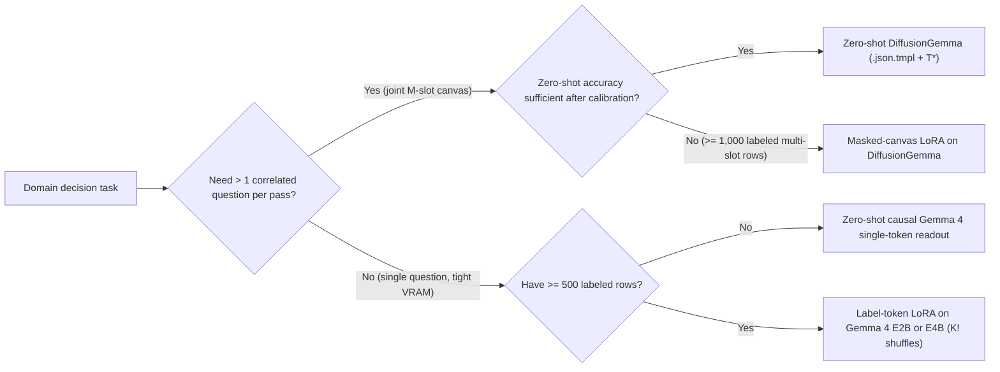

# Build and fine-tune decision models

To build a custom decision model when zero-shot prompt authoring reaches a ceiling, you can either read constrained single-token probabilities from a causal [Gemma 4](https://ai.google.dev/gemma) checkpoint or fine-tune [DiffusionGemma](https://gemma.ai/models/diffusiongemma/) (`26B-A4B-it`) and Gemma 4 (`E2B`, `E4B`, or `27B`) on labeled domain decisions. This guide covers when to stay zero-shot, how to extract calibrated probabilities from causal Gemma 4 models, how to run label-token LoRA supervised fine-tuning (SFT) without introducing ballot-order bias, and how to validate a tuned checkpoint before production rollout.

## Choose a model architecture and training path

Start with zero-shot `.json.tmpl` policy authoring ([Your first decision policy](first-policy.md)) and post-hoc calibration ([Calibrate your policy](../confidence/calibrate-your-policy.md)). Move to custom model weights only when a held-out evaluation receipt (`dgem bench` or `dgem bench-calibration`) shows systematic domain errors that clearer option descriptions cannot resolve, or when strict edge-device memory budgets require a smaller parameter footprint.



The following table compares the four implementation options across pass complexity, joint slot conditioning, hardware footprint, and training requirements:

| Approach | Forward passes for $M$ questions | Joint conditioning across questions | Typical GPU footprint | Labeled training rows needed | Best fit |
| :--- | :--- | :--- | :--- | :--- | :--- |
| **Zero-shot DiffusionGemma (`dgem`)** | $1$ pass (up to canvas limit) | Bidirectional (`slot_1 <-> slot_2`) | $1\times$ 24–96 GB GPU (or 24 GB+ Apple Silicon) | $0$ for inference ($100\text{+}$ to fit $T^*$) | Multi-question policies, frequent rubric edits, zero training pipeline maintenance |
| **Zero-shot causal Gemma 4 readout** | $M$ independent passes (or $M$-step sequential decode) | None across independent passes (left-to-right only if chained) | $1\times$ 8–24 GB GPU (`E2B` or `E4B`) | $0$ for inference ($100\text{+}$ to fit $T^*$) | Single-slot routing on edge or small-VRAM instances |
| **Label-token LoRA on causal Gemma 4** | $M$ independent passes | None across independent passes | $1\times$ 8–24 GB GPU (`E2B` or `E4B`) | $500\text{–}10{,}000$ rows with $K!$ option shuffles | High-throughput single-question classifiers with fixed taxonomies and domain jargon |
| **Masked-canvas LoRA on DiffusionGemma** | $1$ pass for all $M$ questions | Bidirectional across all masked slots | $1\times$ 80–96 GB GPU for training; 24–96 GB for serving | $1{,}000\text{–}25{,}000$ multi-slot rows | Specialized multi-question policies where slots must co-adapt (`urgent` + `team` + `severity`) |

## Read single-token probabilities from causal Gemma 4

A standard causal language model can serve as a single-question decision model without free-text parsing if you constrain generation to **one output token** (`max_tokens=1`) and normalize log-probabilities over the allowed option tokens.

### Enforce a clean token boundary

Causal tokenizers assign distinct token IDs to `"A"` and `" A"` (with a leading space). If your prompt ends with a trailing space (`"Answer: "`), probability mass splits unpredictably between whitespace-prefixed and bare letter tokens. Follow three rules to prevent split vocabulary mass:

1. End the prompt immediately after `"Answer:"` with **no trailing space**, and format few-shot or system instructions so the target token is the space-prefixed token `" A"` (or verify exact single-token IDs with your model's `AutoTokenizer` before serving).
2. Verify that every allowed label (`A` through `Z`, `yes`, `no`, or `1` through `5`) encodes to **exactly one token ID**.
3. Slice the model's top log-probabilities at step `0` over the allowed token IDs $\mathcal{V}$ and compute the restricted softmax:

$$p_k = \frac{\exp(z_k)}{\sum_{j \in \mathcal{V}} \exp(z_j)}, \qquad \tilde{H} = -\frac{1}{\ln |\mathcal{V}|} \sum_{k \in \mathcal{V}} p_k \ln p_k$$

### Extract restricted-softmax probabilities in Python

The following Python function queries a vLLM OpenAI-compatible `/v1/chat/completions` endpoint serving a causal Gemma 4 model and returns restricted-softmax probabilities and normalized hesitation:

```python
from collections.abc import Mapping
import json
import math
import urllib.request


def _logaddexp(first_logprob: float, second_logprob: float) -> float:
  """Aggregate two log-probabilities in log-space without underflow."""
  high_logprob = max(first_logprob, second_logprob)
  low_logprob = min(first_logprob, second_logprob)
  if math.isinf(high_logprob) and high_logprob < 0.0:
    return high_logprob
  return high_logprob + math.log1p(math.exp(low_logprob - high_logprob))


def decide_single_slot_causal(
    endpoint_url: str,
    model_name: str,
    prompt_text: str,
    option_tokens: Mapping[str, str],
) -> dict[str, object]:
  """Read one constrained choice distribution from a causal Gemma endpoint.

  Args:
    endpoint_url: Base OpenAI-compatible `/v1` endpoint URL.
    model_name: Served causal Gemma model identifier.
    prompt_text: Prompt ending cleanly before the single answer token.
    option_tokens: Mapping of canonical option name to single label token.

  Returns:
    Dictionary containing the winning choice, confidence, entropy, normalized
    hesitation, and restricted-softmax option probabilities.
  """
  payload = {
      "model": model_name,
      "messages": [{"role": "user", "content": prompt_text}],
      "max_tokens": 1,
      "temperature": 0.0,
      "logprobs": True,
      "top_logprobs": 32,
  }
  request = urllib.request.Request(
      f"{endpoint_url.rstrip('/')}/chat/completions",
      data=json.dumps(payload).encode("utf-8"),
      headers={"Content-Type": "application/json"},
      method="POST",
  )
  with urllib.request.urlopen(request, timeout=30) as response:
    body = json.loads(response.read().decode("utf-8"))

  # SentencePiece/BPE top_logprobs can include both `" A"` and `"A"` in
  # descending probability order; sum whitespace-equivalent variants via
  # logsumexp so a lower-probability variant never overwrites the dominant one.
  top_candidates = body["choices"][0]["logprobs"]["content"][0]["top_logprobs"]
  observed_logprobs: dict[str, float] = {}
  for candidate in top_candidates:
    normalized_token = str(candidate["token"]).strip()
    if not normalized_token:
      continue
    candidate_logprob = float(candidate["logprob"])
    if normalized_token in observed_logprobs:
      observed_logprobs[normalized_token] = _logaddexp(
          observed_logprobs[normalized_token],
          candidate_logprob,
      )
    else:
      observed_logprobs[normalized_token] = candidate_logprob

  # Floor unseen options at -30.0 logprob so rare options keep finite mass.
  raw_logits = {
      option_name: observed_logprobs.get(letter, -30.0)
      for option_name, letter in option_tokens.items()
  }
  max_logit = max(raw_logits.values())
  exp_scores = {
      name: math.exp(logit - max_logit) for name, logit in raw_logits.items()
  }
  normalizer = sum(exp_scores.values())
  probabilities = {
      name: score / normalizer for name, score in exp_scores.items()
  }

  entropy_nats = -sum(
      prob * math.log(prob) for prob in probabilities.values() if prob > 0.0
  )
  hesitation = (
      entropy_nats / math.log(len(probabilities))
      if len(probabilities) > 1
      else 0.0
  )
  winner = max(probabilities, key=probabilities.get)
  return {
      "choice": winner,
      "confidence": probabilities[winner],
      "entropy": entropy_nats,
      "hesitation": hesitation,
      "probabilities": probabilities,
  }
```

### Multi-question tradeoff on causal models

When a policy contains $M > 1$ questions (for example, `urgent`, `team`, and `sentiment`), a causal model forces a choice between two compromises:

- **$M$ separate forward passes**: Each question has clean single-token probabilities, but slot `2` cannot see slot `1`'s latent state, and total prompt compute scales unless prefix caching hits on a shared `<user_text>` prefix. Place `<user_text>` first ([Prompt layout](prompt-layout.md)) so vLLM `--enable-prefix-caching` reuses the document KV cache across all $M$ passes.
- **Sequential JSON generation**: Generating `{"urgent": "yes", "team": "billing"}` left to right introduces autoregressive exposure bias—an early noisy flip on `urgent` shifts the conditional distribution of `team`, and later questions cannot propagate evidence backward to earlier questions.

By contrast, `DiffusionGemma` places all $M$ masked answer slots on a shared bidirectional canvas and resolves them jointly in **one forward pass** ([How the model decides in one pass](../confidence/architecture.md)).

## Fine-tune causal Gemma 4 with label-token LoRA

When you have $500$ or more labeled examples for a stable single-question taxonomy, low-rank adaptation (LoRA) on `Gemma 4 E2B` or `Gemma 4 E4B` produces a compact, domain-specialized decision model.

### Supervise only the decision token

Standard instruction tuning computes cross-entropy loss across every assistant output token (JSON braces, keys, quotes, and punctuation). For a decision model, formatting loss dilutes gradient updates and distorts calibration. Mask prompt and formatting tokens with `-100` so cross-entropy loss applies **exclusively** to the single target option token $y^* \in \{A, \dots, Z\}$:

$$\mathcal{L}_{\text{label}}(\theta) = -\log P_\theta(t_{\text{target}} = \text{token}(y^*) \mid x, \pi(\mathcal{O}))$$

where $\pi(\mathcal{O})$ is the presented ordering of the option descriptions.

### Eliminate ballot-order memorization with permutation augmentation

If your training dataset lists common classes first, naive SFT learns a strong positional prior toward letter `A` ([Confidence beyond Shannon](../confidence/overview.md)). To keep probabilities invariant to option order:

1. **Permute options during training**: For $K \le 4$ options, expand or sample uniformly from all $K!$ option permutations; for $K > 4$, sample $4$ cyclic or random permutations $\pi$ per training example and relabel the target letter $\pi(y^*)$ accordingly.
2. **Keep option descriptions in the prompt**: Train with the full `"A: <description>"` rubric lines in the prompt rather than bare class IDs. Retaining rubric text lets you refine wording later without retraining from scratch.
3. **Include abstention or out-of-scope rows**: If production traffic can fall outside your known classes, include `other_unclassified` or `insufficient_evidence` examples during SFT so the tuned model does not force out-of-domain inputs into high-confidence false positives.

```python
import hashlib
import random


def permute_training_options(
    example_id: str,
    epoch: int,
    options: list[tuple[str, str]],
    gold_option_name: str,
) -> tuple[list[tuple[str, str]], str]:
  """Deterministically shuffle (name, description) pairs and return target A-Z."""
  seed_bytes = hashlib.sha256(f"{example_id}:{epoch}".encode("utf-8")).digest()
  rng = random.Random(int.from_bytes(seed_bytes[:8], "big"))
  shuffled = list(options)
  rng.shuffle(shuffled)

  letters = "ABCDEFGHIJKLMNOPQRSTUVWXYZ"
  labeled_lines: list[tuple[str, str]] = []
  target_letter = ""
  for idx, (name, description) in enumerate(shuffled):
    letter = letters[idx]
    labeled_lines.append((letter, f"{letter}: {description}"))
    if name == gold_option_name:
      target_letter = letter
  if not target_letter:
    raise ValueError(f"gold option {gold_option_name!r} missing from options")
  return labeled_lines, target_letter
```

### Reference LoRA hyperparameters

Treat the following settings (`r = 16`, `label_smoothing = 0.02–0.05`, and option-permutation counts) as reference starting points rather than fixed universal defaults—tune and calibrate them per policy on a held-out split to prevent logit over-sharpening on datasets of $500\text{–}10{,}000$ rows:

- **Rank and alpha**: `r = 16`, `lora_alpha = 32`, `lora_dropout = 0.05` targeting attention projections (`q_proj`, `k_proj`, `v_proj`, `o_proj`).
- **Label smoothing**: `0.02` to `0.05` over the valid option tokens $\mathcal{V}$ (prevents logits from collapsing to $\pm\infty$ and preserves usable hesitation gradients).
- **Epochs and early stopping**: `2` to `3` epochs, selecting the checkpoint with the lowest held-out **negative log-likelihood (NLL)** and **Brier score** rather than raw top-1 accuracy alone.

## Fine-tune DiffusionGemma on a masked decision canvas

When your application evaluates multiple interdependent questions at once (for example, `action_hazard` + `intent_origin` in tool-call safety gating, or `claim_supported` + `contradiction_type` in grounding verification), fine-tuning `DiffusionGemma` preserves single-pass joint conditioning across all slots.

### Multi-slot masked-canvas objective

Construct each training example using the exact `document_first` canvas structure served by `structured_server.py`: causal attention over `<user_text>` and `<instructions>`, followed by bidirectional attention over the seeded JSON answer canvas where every answer value token $s_m$ is replaced by `[MASK]`:

```json
{
  "schema": {
    "instructions": "Triage incoming customer billing and outage tickets.",
    "questions": [
      {
        "id": "urgent",
        "type": "boolean",
        "instructions": "Does this ticket report an active production outage or duplicate charge?"
      },
      {
        "id": "team",
        "type": "choice",
        "instructions": "Which engineering or support queue owns this ticket?",
        "options": [
          {"name": "billing", "description": "Invoices, duplicate charges, and refunds"},
          {"name": "sre", "description": "Service outages, latency spikes, and 5xx errors"},
          {"name": "account", "description": "Login, SSO, and role changes"}
        ]
      }
    ]
  }
}
```

Compute the weighted cross-entropy loss solely at the $M$ masked slot indices $\mathcal{I}_{\text{slots}} = \{i_1, \dots, i_M\}$, keeping non-slot canvas scaffold tokens unmasked (`loss_mask = 0`):

$$\mathcal{L}_{\text{canvas}}(\theta) = -\sum_{m=1}^{M} w_m \log P_\theta\!\left(c_{i_m} = \text{token}(y_m^*) \;\middle|\; x, c_{\setminus \mathcal{I}_{\text{slots}}}\right)$$

Apply per-question option-permutation augmentation (`permute_training_options`) independently to every `choice` question on the canvas, and verify that no two questions share colliding letter semantics without neutral question IDs ([Authoring and Stage 2 cascades](authoring.md)). As with causal LoRA, treat `r = 16`, `label_smoothing` (`0.02–0.05`), and the option-permutation schedule as reference starting points rather than fixed universal defaults: tune hyperparameters and fit post-hoc calibration parameters per policy on a held-out validation split.

### Adapt shared encoder-decoder weights and freeze self-conditioning

DiffusionGemma ties its causal prompt encoder and bidirectional canvas decoder to one shared 30-layer backbone (`_tied_weights_keys`). Follow four architecture rules when tuning `26B-A4B-it` checkpoints:

1. **Attach one shared LoRA module across encoder and decoder modes.** Attaching separate adapters to `encoder` and `decoder` wrappers trains distinct low-rank deltas in-process that sum when merged into the tied checkpoint, causing served evaluations to drift from training metrics. Attach LoRA once to the canonical attention (`q_proj`, `k_proj`, `v_proj`, `o_proj`) and dense MLP projections so both causal prompt prefill and single-step slot readout share identical adapted weights, while keeping the 128 routed 3D experts and MoE router frozen.
2. **Freeze `self_conditioning` for single-step (`steps = 1`) policies.** At `steps = 1`, the initial latent state is exact zero, and the bias-free `self_conditioner` projections emit zero activations and receive zero gradient. Set `self_cond_prob = 0.0` and leave `self_conditioning` frozen unless the same checkpoint also serves multi-step generation.
3. **Match `"seed_token": "fixed"` across training and serving, and regularize early validation peaks.** Because single-slot classification supervises at most one token (`0.69` nats for binary tasks) per prompt, adapters with `r = 64` (useful for deep code or domain feature extraction during causal prefill) can peak within the first `50`–`300` optimizer steps before memorizing repository-specific identifiers. Use a lower learning rate (`2e-5` to `5e-5` with cosine decay), `lora_dropout` (`0.05`–`0.10`), and `label_smoothing` (`0.02`–`0.05`), and evaluate held-out NLL and AUROC every `25`–`50` steps.
4. **Eliminate delimiter variance structurally before adding consistency losses.** If your prompt wraps untrusted inputs in randomized delimiter nonces, switch to JSON-escaped envelopes or fixed-token-width numeric delimiters first ([Prompt layout](prompt-layout.md)). When randomized tags are mandatory during fine-tuning, pair two nonce draws per case in the same batch with a symmetric Kullback-Leibler (KL) penalty on the restricted slot logits rather than training on unpaired draws with cross-entropy alone.

## Recalibrate and verify before serving

Supervised fine-tuning almost always increases raw logit magnitudes, making raw restricted-softmax probabilities **more overconfident** even when top-1 accuracy improves. Never deploy a fine-tuned decision model with `temperature: 1.0` assumed by default.

Run four verification gates before promoting a tuned checkpoint:

1. **Hold out a disjoint calibration and test split**: Keep your evaluation and calibration sets strictly separate from LoRA training rows.
2. **Measure permutation flip rate**: Run `dgem bench-permutation` on your target policies to verify that option-order flips stay at or below the base checkpoint's baseline.
3. **Fit per-policy temperature $T^*$ and hesitation thresholds**: Run your tuned endpoint against the held-out dataset ([Run a dataset](datasets.md)) and fit post-hoc temperature scaling with `scripts/policy_calibration.py`:

   ```bash
   ./bin/dgem bench -u "<CLOUD_RUN_URL>/v1" --gcp-auth \
     -d heldout_eval.jsonl -M slot -o tuned_receipt.json
   python3 scripts/policy_calibration.py results_receipt.jsonl
   ```

4. **Compare against the production baseline in one session**: Run the regression matrix ([Regression matrix](../operate/regression-matrix.md)) with both the current model and the candidate checkpoint live so differences are judged against measured session noise:

   ```bash
   python3 scripts/bench_matrix.py run --tier T1 \
     --target baseline="https://<BASELINE_URL>/v1" \
     --target tuned="https://<CANDIDATE_URL>/v1" \
     --baseline baseline
   ```
