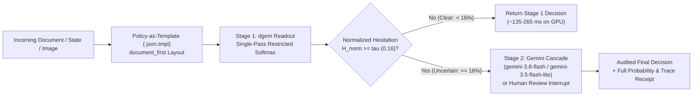
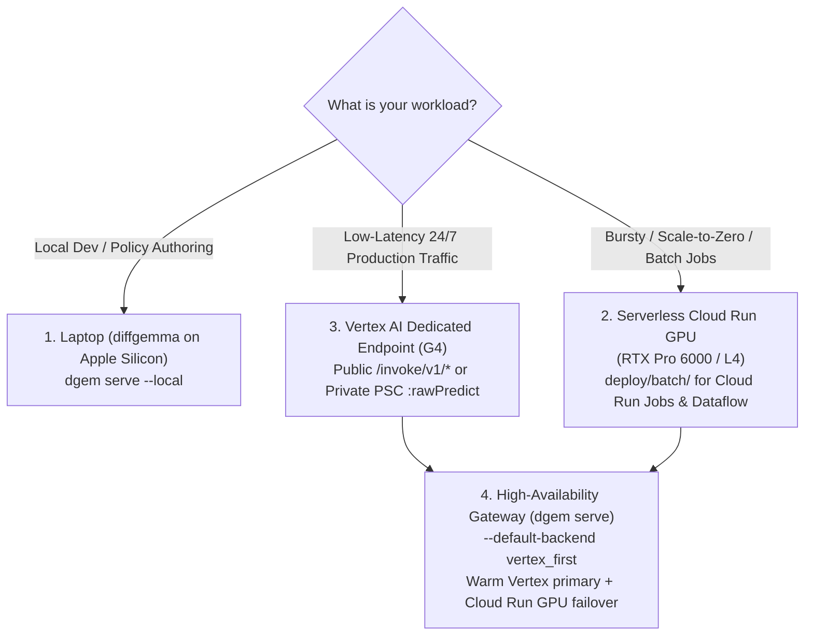

# Decision Models Practitioner Guide: Building Production Systems with `dgem`

> **Audience**: Software Engineers, ML Platform Architects, and Applied AI Practitioners
> **Runtime**: `dgem` (`DiffusionGemma 26B-A4B IT`) across Apple Silicon (`diffgemma`), Cloud Run GPU, and Vertex AI Dedicated Endpoints

---

## Executive Summary

Most production AI workloads are not open-ended conversations. They are **structured decisions**: routing support tickets, triaging security alerts, screening pull requests, verifying policy compliance, classifying user intent across large catalogs, and gating agent tool executions.

When teams use autoregressive reasoning models for every high-volume classification or routing turn, they pay a steep tax in latency (seconds of sequential token generation), compute cost, and brittle post-hoc confidence heuristics. Conversely, traditional task-specific classifiers require curated training pipelines and cannot adapt zero-shot when a policy changes.

**`dgem`** bridges these two worlds by operating [`DiffusionGemma`](https://gemma.ai/models/diffusiongemma/) (`26B-A4B` Mixture-of-Experts, ~`3.8B` active parameters per forward pass) as a **Zero-Shot System-1 Decision Model**:

1. **Declarative Policies (`.json.tmpl`)**: You express business logic as version-controlled Go templates (`templates/*.json.tmpl`) with explicit `choice`, `boolean` (`noul`), or ordinal `score` slots.
2. **Single-Pass Parallel Readout**: Instead of generating a chain-of-thought token by token, `dgem` resolves up to 8 decision slots simultaneously in a single discrete diffusion denoising pass (~`135–265 ms` warm on GPU).
3. **Intrinsic Epistemic Hesitation ($\tilde{H}_m$)**: Because every slot is scored via restricted softmax over its exact allowed vocabulary $\mathcal{V}_m$, `dgem` emits an exact probability distribution and **Cardinality-Normalized Shannon Entropy** ($\tilde{H}_m \in [0, 1]$) on every read.
4. **Selective System-2 Escalation**: Easy, low-entropy decisions ($\tilde{H}_m < 0.16$) finish immediately in Stage 1. Ambiguous or out-of-distribution inputs ($\tilde{H}_m \ge 0.16$) automatically escalate to a Stage-2 Gemini model (`gemini-3.8-flash` or `gemini-3.5-flash-lite`) or a human review queue.

---

## 1. Where `dgem` Fits in Your Stack

In a two-stage decision architecture, `dgem` serves as the **System-1 reflex layer** in front of heavier **System-2 reasoning models** or human-in-the-loop workflows:

| Architectural Property | Autoregressive LLM Prompting | Traditional Fine-Tuned Classifier | `dgem` Decision Model (Stage 1 + Cascade) |
| :--- | :--- | :--- | :--- |
| **Policy Adaptability** | Zero-shot (prompt edit) | Requires retraining & redeploying | **Zero-shot** (`.json.tmpl` edit) |
| **Multi-Question Latency** | Scales with output length & reasoning trace | Fast, single-head | **Single forward pass** for up to 8 slots |
| **Output Contract** | Can fail JSON formatting or hallucinate keys | Fixed class index | **Restricted softmax** over exact schema options |
| **Uncertainty Signal** | Verbalized confidence is poorly calibrated | Needs per-head temperature fitting | **Normalized entropy $\tilde{H}_m$** + optional calibration |
| **Stage-2 Escalation** | Runs expensive model on 100% of traffic | Ad-hoc threshold per head | **Principled hesitation gate** ($\tilde{H}_m \ge \tau$) |

---

## 2. End-to-End Request Lifecycle

Every `dgem` decision follows a deterministic five-step pipeline across the CLI (`dgem decide`), HTTP Gateway (`POST /api/decide`, `POST /v1/systemone`), MCP Server (`dgem mcp`), and Web Studio:

1. **Template Compilation (`pkg/template`)**: The `.json.tmpl` policy renders caller variables into a JSON payload containing the input `state` and an array of `questions`.
2. **Prompt Layout Construction (`document_first`)**: By default (`DEFAULT_LAYOUT=document_first`), the serving image places the input document/state first and the question schema second inside the user turn so every question attends to the document from the start of the prompt ([Prompt layout](policies/prompt-layout.md)).
3. **Single-Pass Restricted Softmax (`deploy/cloudrun/server/structured_server.py`)**: For each question $m$ with option vocabulary $\mathcal{V}_m$ (mapped to single-token option labels `A`–`Z`, or up to 52 labels with opt-in `az_aa` / `az_lower`), the model extracts the slot logits $z_{m,v}$ and computes restricted-softmax probabilities with optional temperature scaling $T_m^*$:
   $$p_m(v \mid x) = \frac{\exp(z_{m,v} / T_m^*)}{\sum_{u \in \mathcal{V}_m} \exp(z_{m,u} / T_m^*)}$$
4. **Cardinality-Normalized Hesitation ($\tilde{H}_m$)**: Raw Shannon entropy $H_m = -\sum_{v \in \mathcal{V}_m} p_m(v)\ln p_m(v)$ grows with the number of options $|\mathcal{V}_m|$. Dividing by $\ln |\mathcal{V}_m|$ yields a scale-free hesitation score in $[0, 1]$:
   $$\tilde{H}_m = \frac{H_m}{\ln |\mathcal{V}_m|} \in [0, 1]$$
   In the Web Studio and CLI (`studio/src/hesitation.ts`), $\tilde{H}_m < 0.16$ is reported as **Clear**, $0.16 \le \tilde{H}_m \le 0.50$ as **Somewhat Unsure**, and $\tilde{H}_m > 0.50$ as **Very Unsure** ([Confidence beyond Shannon](confidence/overview.md)).
5. **Post-Processing & Escalation (`cmd/serve.go`, `pkg/decisionindex`)**: When `cascade_mode: "entropy"` is enabled and a slot exceeds `cascade_threshold`, `dgem` opens an OpenTelemetry child span (`dgem.cascade.gemini`) and escalates that question to `gemini-3.8-flash` or `gemini-3.5-flash-lite` ([Authoring and Stage 2 cascades](policies/authoring.md)).

---

## 3. What Works in Production (Graduated Patterns)

Each feature below is validated against `dgem`'s regression matrix ([Regression matrix](operate/regression-matrix.md)) and exposed with consistent semantics across the CLI, HTTP Gateway, MCP Server, and Studio.

### 3.1 Hesitation-Gated Cascades ($\tilde{H}_m \ge 0.16$) and Temperature Scaling ($T^*$)

Raw restricted-softmax probabilities provide a strong zero-shot ranking signal for separating confident answers from errors.
- **Selective Escalation**: Gate Stage-2 calls (`gemini-3.8-flash` or `gemini-3.5-flash-lite`) or human-approval interrupts (`examples/genkit-tool-approval/`) on normalized entropy $\tilde{H}_m \ge 0.16$ (or raw entropy $H_m \ge 0.35\text{ nats}$).
- **Per-Policy Calibration**: When downstream consumers need probabilities that match empirical accuracy (low ECE / Brier score), fit a post-hoc temperature $T^*$ (`temperature` or `temperature_by_type` in your `.json.tmpl`) on a held-out labelled split using `scripts/policy_calibration.py` ([Calibrate your policy](confidence/calibrate-your-policy.md)).

### 3.2 Document-First Prompt Layout (`document_first`)

Placing the document/state before the question definitions (`layout: "document_first"`, the default in the serving image and `dgem systemone serve`) improves accuracy on long-context Grounded NLI, hallucination detection, and catch-all intent suites without adding latency ([Prompt layout](policies/prompt-layout.md)).

### 3.3 Multi-Slot Canvas Batching ($\le 8$ Questions) and Conditional DAGs

- **Independent Questions**: Group up to 8 related questions (`MaxSlotsPerPass = 8`) into a single `.json.tmpl` policy (for example, `templates/support_triage.json.tmpl` or `templates/github_spam_triage.json.tmpl`). All slots are answered in one forward pass. Beyond 8 questions, `pkg/decisionindex` automatically partitions questions into multi-slot batches.
- **Sequential Dependencies (`depends_on` / `ask_if`)**: When a follow-up question only makes sense given an earlier answer (for example, asking for severity only when `is_incident == "yes"` in `templates/secops_conditional_dag.json.tmpl`), declare `depends_on` and `ask_if: ["yes"]`. Leave them out when a single pass suffices.

### 3.4 Wide-Option Taxonomies ($K > 26$ Options)

The serving image maps `choice` options to single letters `A`–`Z` by default (`MaxOptionsPerSlot = 26`). When a taxonomy has more than 26 options (such as 77 banking intents or 151 cross-domain intents), `dgem` offers three graduated strategies:

| Strategy | Flag / Option | Passes | Best For |
| :--- | :--- | :---: | :--- |
| **1. Two-Stage Bracket Tournament** *(Default)* | `--bracket-size 20` (`dgem systemone serve`) | $2+$ | Maximum zero-shot accuracy up to $K = 255+$ options with no external retriever required. |
| **2. Extended 52-Option Label Sets** *(Experimental)* | `--labels az_aa` or `az_lower` | $1$ (up to $K=52$) | Medium-wide taxonomies ($27 \le K \le 52$) when running against a serving image with label-set support. |
| **3. Pre-Filtered Shortlist Routing** *(Opt-in)* | `--shortlist-topk M` (e.g. `M=15`) + `prior_logits` | $1$ | Latency-critical wide choices ($K > 26$, measured up to $K = 151$) when an upstream bi-encoder or lexical ranker supplies `prior_logits`. |

- **Catch-All Handling (`--catch-all`)**: On wide taxonomies that include an `"out_of_scope"` or `"none of the listed"` option, `--catch-all final` holds the catch-all out of Round-1 brackets and injects it into the final round, while `ShortlistFunc` automatically preserves catch-all keys alongside the top-$M$ shortlist.
- **Cosine Prior Normalization (`NormalizeCosinePriorLogits`)**: Raw bi-encoder cosine similarities in $[-1, 1]$ occupy a narrow numeric range. Before passing embedding scores as `prior_logits`, convert them to temperature-scaled log-softmax logits with `decisionindex.NormalizeCosinePriorLogits(cosines, 0.07)` so they live on a proper log-probability simplex while preserving exact rank order.

### 3.5 Opt-In Pre-Gated Prior Fusion (`--prior-weight`, `--prior-gate-mode`)

When callers supply per-option log-priors (`prior_logits` on a `/v1/systemone` question, such as historical class base rates or retrieval log-probabilities), `dgem` can combine them with the model's log-probabilities via log-linear Product-of-Experts fusion (`pkg/decisionindex/engine.go`):

1. **Pre-Fusion Hesitation Invariant (`raw_normalized_entropy`)**: `FusePriorWithGateMode` always computes and records `raw_entropy` and `raw_normalized_entropy` ($\tilde{H}_{\text{raw}}$) **before** applying `prior_logits`. Downstream Stage-2 cascades must gate on `raw_normalized_entropy` so a sharp external prior never masks model uncertainty.
2. **Choosing a Gate Mode (`--prior-gate-mode`)**:
   - `hesitant` *(Recommended for tie-breaking)*: Fuses `prior_logits` only when the model is uncertain ($\tilde{H}_{\text{raw}} \ge \tau$, default $\tau = 0.16$), leaving confident model predictions untouched even if the prior disagrees.
   - `proportional`: Scales the effective prior weight by $\alpha \cdot \tilde{H}_{\text{raw}}$, smoothly increasing prior influence as model hesitation rises.
   - `confident`: Fuses only when $\tilde{H}_{\text{raw}} < \tau$.

### 3.6 Co-Denoised Evidence Slots (`evidence_prompt` + `evidence_criteria`)

For fine-grained visual or textual verification on standard choice questions ($K \le 26$), a question on `/v1/systemone` can include `evidence_prompt` and caller-supplied `evidence_criteria` ($\ge 2$ options).
- The adapter places a companion `<question_id>_evidence` choice slot immediately ahead of `<question_id>` on the **same diffusion canvas** (consuming 2 of the 8 slots in that pass) and returns the selected cue in `answers[q].evidence`.
- For multi-image visual inspection (`templates/multimodal/contact_sheet_verify.json.tmpl`), tiling candidate crops into a numbered contact sheet and asking an evidence slot to identify the matching tile before the final decision slot resolves the comparison in a single forward pass.

### 3.7 Guided Object Localization (`dgem locate`)

`dgem` is a discrete choice and scoring engine, not a continuous coordinate regressor. For image localization (`dgem locate`, `POST /api/locate`, MCP `locate_object`; see [What dgem can do with images](policies/images.md)):
1. **Stage 1 (`dgem`)**: Answers target presence and coarse 3×3 grid cell in one pass. With `--skip-h 0.16`, images where `dgem` is confidently `"absent"` return immediately (`path: "skipped_absent"`), saving the Stage-2 call.
2. **Stage 2 (`gemini-3.8-flash` / `gemini-3.5-flash-lite`)**: Predicts continuous `box_1000` / `box_pct` coordinates at `low` thinking.
3. **Optional Stage 3 (`DGEM_SAM_URL`)**: Refines the bounding box into a pixel mask and polygon.

---

## 4. What Does Not Work (Anti-Patterns to Avoid)

 Empirical testing across the `dgem` evaluation suites ruled out several tempting heuristics. Avoid these patterns in production:

| Anti-Pattern | What Happens | What to Do Instead |
| :--- | :--- | :--- |
| **Direct continuous `[0..1000]` coordinate regression in `dgem` choice slots** | Quantizing image coordinates into 16 or 26 discrete bins yields coarse boxes and quantization rounding error. | Use **`dgem locate`** (`dgem` presence + 3×3 cell gate $\to$ `gemini-3.8-flash` bounding box $\to$ optional SAM mask). |
| **Gating Stage-2 cascades on post-fusion `normalized_entropy` when `prior_logits` are fused** | A strong but wrong external prior depresses post-fusion entropy on errors, collapsing error-detection AUROC. | Always gate cascades on pre-fusion **`raw_normalized_entropy`** and prefer `--prior-gate-mode hesitant` or `proportional`. |
| **Overpacking $>8$ independent questions into one raw pass** | Exceeding the 256-token output canvas degrades slot formatting and per-question accuracy. | Keep policies to $\le 8$ questions per pass, or route through `POST /v1/systemone` (`MaxSlotsPerPass = 8` auto-batching). |
| **Enabling `--shortlist-contrastive` by default on compact `snake_case` intent keys** | Appending `[distinguishing: ...]` sibling token tags helps verbose overlapping product descriptions, but hurts compact intent names (e.g. `banking77`). | Keep `--shortlist-contrastive=false` (the default) unless A/B tested on verbose overlapping catalog descriptions. |
| **Enabling `--null-prior-debias` or `--dual-mirror` in production** | Content-free positional de-biasing helps one suite while hurting another; dual-mirror doubles slot consumption with little gain over $\tilde{H}_m$. | Keep both flags off in production; use neutral question IDs and `document_first` layout ([Confidence and calibration](confidence/index.md)). |
| **Using bias-inducing question IDs (`mirror`, `reverse`, `opposite`, `alt`)** | Question IDs are part of the prompt seen by the model; suggestive names shift the answer distribution. | Use neutral, descriptive snake_case IDs (`intent`, `urgency`, `policy_violation`). |

---

## 5. Choosing Your Deployment Topology

`dgem` supports four execution topologies behind a single CLI, Gateway, and MCP interface ([From laptop to production](deploy/index.md)):

| Topology | Typical Warm Latency | Cold Start | Scaling & Cost Profile | Guide |
| :--- | :--- | :--- | :--- | :--- |
| **1. Apple Silicon (`diffgemma`)** | `~250–600 ms` (M-series Max/Ultra) | Instant | Free local iteration (`32 GB+` unified memory) | [Run on your laptop](deploy/laptop.md) |
| **2. Cloud Run GPU (`dgemma`)** | `~185–265 ms` (1–3 questions) | `~2–3 min` from zero | Scales `0..N` per-second GPU billing; ideal for bursty traffic & `deploy/batch/` | [Deploy on Cloud Run](deploy/cloud-run.md) · [Batch guide](deploy/batch.md) |
| **3. Vertex AI Dedicated (`G4`)** | `~135–185 ms` (1–3 questions) | `0 ms` (always warm) | Dedicated 24/7 GPU node(s); supports public `/invoke/v1/*` and private PSC `:rawPredict` | [Production on Vertex AI](deploy/vertex.md) · [Vertex vs. Cloud Run](reference/vertex-vs-cloud-run.md) |
| **4. Gateway (`vertex_first`)** | `~135–185 ms` | Masked by failover | Routes to warm Vertex AI primary with automatic Cloud Run GPU failover & Stage-2 Gemini cascade | [Gateway and routing](deploy/gateway.md) |

---

## 6. Production Launch Checklist

Before promoting a new `.json.tmpl` policy or serving configuration to production:

1. **Schema & Layout Hygiene**:
   - Keep `choice` questions to $\le 26$ options per pass (or configure `/v1/systemone` tournament brackets / `--shortlist-topk` / `--labels az_aa`).
   - Use neutral question IDs, `samples: {{ default 1 .samples | toJson }}`, and `document_first` layout.
2. **Calibration & Escalation**:
   - Evaluate your policy on a labelled dataset ([Run a dataset](policies/datasets.md)) and inspect hesitation $\tilde{H}_m \to$ error AUROC.
   - Configure Stage-2 escalation (`--cascade-model gemini-3.8-flash` or `gemini-3.5-flash-lite`) or Genkit tool-approval interrupts (`examples/genkit-tool-approval/`) on $\tilde{H}_m \ge 0.16$ (or `raw_normalized_entropy` when `prior_logits` fusion is enabled).
3. **Security & Credentials**:
   - Protect the serving image with `DGEM_SERVER_KEY` (`X-DGem-Key`) and the HTTP gateway with Cloud Run IAP (`--iap-audience`) or `--api-keys` (`X-DGem-Api-Key`) ([Security and access](operate/security.md)).
4. **Regression Gate**:
   - Run T0/T1 verification via `scripts/bench_matrix.py` before switching traffic ([Operations runbook](operate/runbook.md) · [Regression matrix](operate/regression-matrix.md)).
