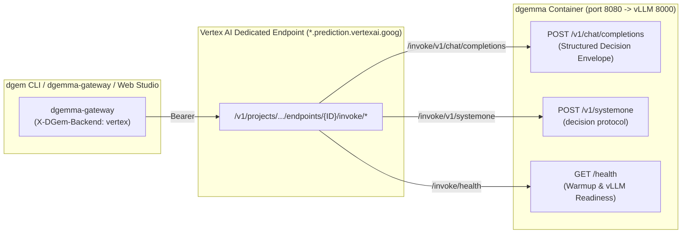

# Vertex AI Dedicated Endpoints (`/invoke/*`) vs. Cloud Run GPU

Reference for the two cloud runtimes behind `dgem`: why Vertex uses arbitrary custom routes and how the platforms
differ in features and operation. Both run the same serving image. For step-by-step setup, follow
[From Laptop to Production](../deploy/index.md): [Deploy on Cloud Run](../deploy/cloud-run.md),
[Production on Vertex AI](../deploy/vertex.md) and [Gateway and routing](../deploy/gateway.md). To compare latency
and capacity on your own deployments, see [Latency and capacity](../operate/latency-capacity.md).

---

## 1. Why We Use Vertex AI Arbitrary Custom Routes (`invokeRoutePrefix: "/*"`)

Standard Vertex AI Online Prediction (`:predict` and `:rawPredict`) binds a container deployment to a **single fixed HTTP path** (`AIP_PREDICT_ROUTE`). However, the `dgemma` container (`structured_server.py` on port `8080` fronting `vLLM EngineCore` on port `8000`) exposes **three HTTP routes**, all for decisions or readiness:

- `POST /v1/chat/completions` — Structured 128-token diffusion decision envelope (`answers` + `diagnostics`).
- `POST /v1/systemone` — The `/v1/systemone` decision protocol (JSON or multipart image + JSON).
- `GET /health` — Live container warmup phase, staged GiB telemetry, and `vllm_ready` flag.

Free-form generation (`/v1/raw/chat/completions` in vLLM's upstream example) is not served: the serving image answers it with `410 Gone`.

By uploading the model with **[`invokeRoutePrefix: "/*"`](https://docs.cloud.google.com/gemini-enterprise-agent-platform/machine-learning/predictions/use-arbitrary-custom-routes)** and deploying it to a **Vertex AI Dedicated Endpoint** (`dedicatedEndpointEnabled: true`), Vertex AI forwards any non-root path under `/invoke/<path>` **verbatim** as `/<path>` to `structured_server.py`:

---

## 2. Feature Differences: Cloud Run GPU vs. Vertex AI Dedicated Endpoints

| Dimension | Serverless Cloud Run GPU (`dgemma`) | Vertex AI Dedicated Endpoint (`dgemma-dedicated-g4`) |
| :--- | :--- | :--- |
| **Scale-to-Zero (`min=0`)** | **Yes (`--min-instances=0`)** — Scales down after an idle period; no GPU cost while idle. | **No (`minReplicaCount >= 1`)** — Bills per replica-hour while a model is deployed, until undeployed (`make vertex-teardown`). |
| **Cold-Start / Provisioning** | A few minutes idle → warmed: weights are copied from Cloud Storage into memory (fastest with Direct VPC egress), overlapped with vLLM start-up. | Deploying a model takes roughly 10–15 minutes; replicas then stay warm (no wake-up). |
| **Supported GPU Shapes** | `1× NVIDIA L4` (`24GB VRAM`, `32Gi RAM`) or `1× NVIDIA RTX Pro 6000 Blackwell` (`48GB VRAM`, `80Gi RAM`). | `g4-standard-48` + 1× RTX PRO 6000 (recommended; native NVFP4), plus L4 (`g2-*`), A100 (`a2-*`) and H100 (`a3-*`) machine types (the serving image is tested only on RTX PRO 6000 and L4). |
| **Multimodal (vision tower)** | Single-GPU RTX PRO 6000 (80 GiB RAM) runs the model and the vision tower. | `g4-standard-48` + RTX PRO 6000 runs NVFP4 weights and the vision tower on one GPU. |
| **Routing Protocol** | Direct HTTPS to `https://dgemma-*.a.run.app/v1/chat/completions` | Arbitrary Custom Routes (`invokeRoutePrefix: "/*"`) via `https://<id>.<region>-<proj_num>.prediction.vertexai.goog/v1/projects/.../endpoints/<id>/invoke/v1/chat/completions` |
| **Authentication Token** | **OIDC Identity Token** (`gcloud auth print-identity-token`, audience = Cloud Run URL) | **OAuth2 Access Token** (`gcloud auth print-access-token`, scope = `cloud-platform`) |
| **Payload Size Limit** | Cloud Run request size limits (HTTP/1.1 requests are capped; HTTP/2 streaming is not) | Dedicated endpoint (`*.prediction.vertexai.goog`) limits, which are higher than the shared `:predict` endpoint's; check the current Vertex AI documentation before sending large images |
| **Health Probe Behavior** | Polls `GET /health` (`200 OK` immediately so gateway can read live staging telemetry during scale-from-zero). | Startup probe on `GET /health` (long timeout); readiness fields as on Cloud Run. |
| **Enterprise MLOps Features** | Revision traffic splitting, Direct Cloud Run IAP, Cloud Logging & Monitoring. | Model Registry versioning, Private Service Connect (PSC) endpoints, traffic-split canary rollouts (`deployedModels/{id}/invoke/*`), DCGM GPU AutoMetrics. |

---

## 2.1 Deployment Notes

1. **Why `g2-standard-16` (`64 GB` RAM) is Required for `1× NVIDIA L4` on Vertex AI (`VERTEX_PROFILE=l4`)**:
   - `g2-standard-8` (`1× NVIDIA L4`) provides only **`32 GB` of host RAM**. Staging the `17.53 GiB` `dgemma` safetensors into `/tmp/dgemma` (`tmpfs` in RAM) while `vLLM`/PyTorch allocates a `17.53 GiB` CPU load buffer requires **`~35.1 GiB` of RAM**, causing a container OOM kill on `g2-standard-8`.
   - **`g2-standard-16`** attaches the **exact same single `1× NVIDIA L4` GPU** (`24 GB` VRAM) with **`64 GB` of host RAM** and `16 vCPUs`, eliminating the `32 GB` RAM bottleneck for negligible incremental CPU cost.
2. **2-Second `/health` Startup for Vertex AI Health Probes**:
   - Vertex AI Dedicated Endpoints fail `deploy-model` if port `:8080/health` does not respond during container initialization. [`deploy/cloudrun/entrypoint.sh`](https://github.com/GoogleCloudPlatform/dgem/blob/main/deploy/cloudrun/entrypoint.sh) stages only the `<20 MB` tokenizer + `4 MB` safetensors headers synchronously (`<2 seconds`), launches `structured_server.py` on `:8080` immediately so `/health` returns `200 OK`, and streams the `17.53 GiB` tensor bodies in the background across 64 HTTPS Range streams while `_wait_for_upstream()` holds early inference requests until `vLLM` on `:8000` is ready.

---

## 3. Routing and deployment

Backend modes (`vertex_first`, `vertex`, `cloudrun`, `local`) and per-request overrides:
[Gateway and routing](../deploy/gateway.md). Deploying, swapping images and tearing down a dedicated endpoint:
[Production on Vertex AI](../deploy/vertex.md).
